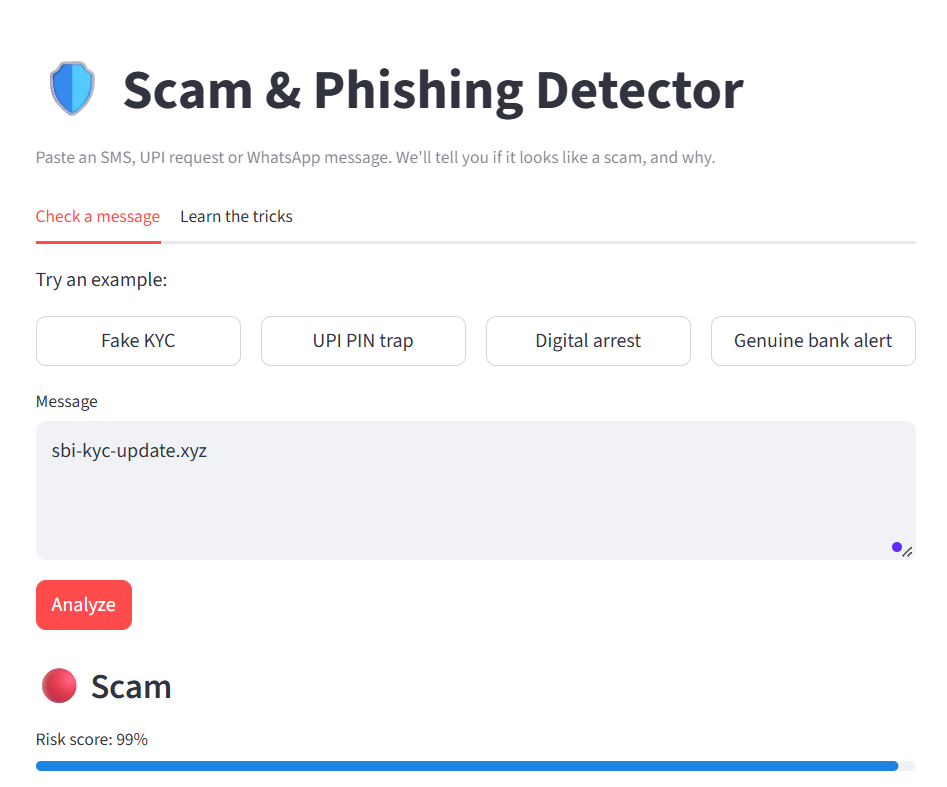
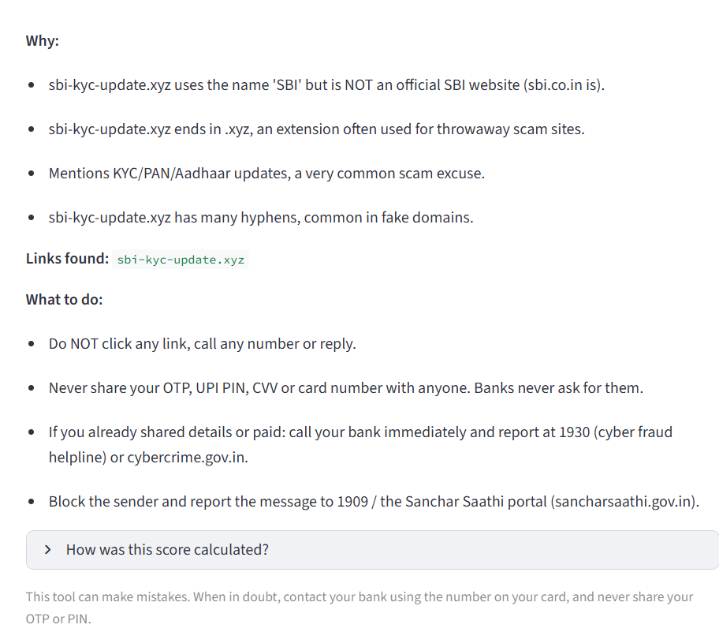

# 🛡️ SMS / UPI Scam & Phishing Detector

A simple web app that checks a suspicious SMS, UPI request or WhatsApp message and tells you
**whether it looks like a scam, and why**, in plain English, with clear next steps.

> India loses thousands of crores every year to UPI, KYC and phishing scams. Most people only
> learn the tricks *after* being scammed. This project explains the red flags in the message itself.




## Features
- **Verdict:** Scam / Suspicious / Looks safe, with a risk score
- **Explains why:** fake urgency, requests for OTP/PIN, UPI "collect request" traps, remote-access apps, fake job/loan offers, "digital arrest" threats
- **Link checks:** look-alike bank domains (e.g. `sbi-kyc-update.xyz`), shortened links, risky extensions, raw IP links
- **What to do next:** helpline 1930, cybercrime.gov.in and safe-practice tips
- **Learn tab:** the 5 most common scammer tricks

## How it works
```
message ──► ML text model (TF-IDF + Logistic Regression) ──┐
   │                                                       ├─► final risk score ─► verdict + reasons
   └─────► rule checks (text tricks + URL analysis) ───────┘
```
Final risk = 55% ML probability + 45% rule score. A single very strong red flag (asking for your
PIN/OTP, remote-access app) always raises the verdict.

## Project structure
```
app.py                  Streamlit web app
train.py                Trains the model and prints metrics
data/generate_data.py   Generates the starter (synthetic) dataset
scamdetector/rules.py   Rule-based text + URL checks
scamdetector/model.py   Preprocessing, training pipeline, model loading
scamdetector/analyzer.py Combines ML + rules into one result
tests/                  Unit tests (pytest)
```

## Run it
```bash
git clone https://github.com/hemathp1418-ctrl/phishing-scam-detector.git
cd phishing-scam-detector
python -m venv venv && source venv/bin/activate    # Windows: venv\Scripts\activate
pip install -r requirements.txt

python data/generate_data.py    # creates data/messages.csv
python train.py                 # trains and saves models/scam_model.joblib
streamlit run app.py            # opens the app in your browser
pytest                          # runs the tests
```

## ⚠️ Limitations (please read)
- **The starter dataset is synthetic.** It is generated from templates modelled on common scams, so
  the perfect scores printed by `train.py` are **not** a real-world accuracy figure.
- The rules were tuned on a small set of hand-written examples, so there may be messages they miss
  or wrongly flag. Always double check with your bank using the number on your card.
- Currently English only. It's a learning project, not a replacement for official fraud protection.

## Improve the model (next steps)
1. Replace or extend `data/messages.csv` with real labelled messages (only use data you are allowed
   to use, and remove personal details such as names and phone numbers first).
2. Build a small hand-labelled **test set** the model never trains on, and report real precision/recall.
3. Add Hindi and Kannada message support.
4. Add an LLM-generated explanation in the user's language.
5. Check links against a live blocklist (e.g. Google Safe Browsing API).
6. Deploy on Streamlit Community Cloud or Render.

## Tech
Python · scikit-learn · pandas · Streamlit · pytest

## Disclaimer
Educational project. It may make mistakes and is not financial or legal advice. If you lost money
to a scam, call **1930** and report at **cybercrime.gov.in** immediately.
